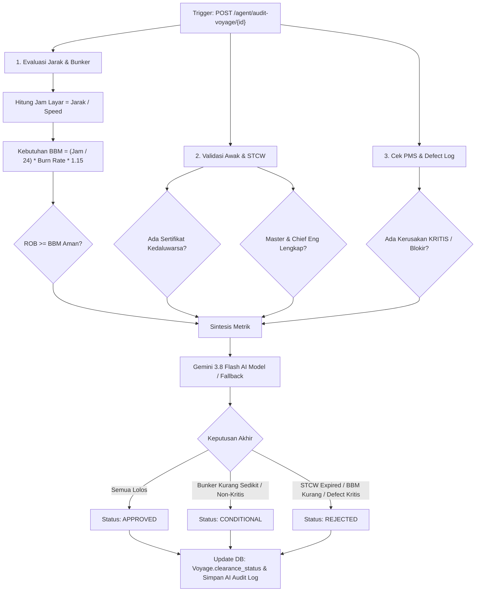

# 🚢 Nautical ERP Automation — Autonomous Maritime Operations & Voyage Clearance Engine

> **Portofolio Project / Enterprise MVP**  
> Dibangun dengan **Python FastAPI**, **PostgreSQL** (Async SQLAlchemy 2.0), dan **Google Gemini 3.8 Flash (`google-genai` SDK)** sebagai **AI Maritime Superintendent Agent**.

---

## 🧭 Latar Belakang & Domain Masalah

Industri pelayaran niaga (*commercial shipping & maritime logistics*) mengelola aset kapal bernilai jutaan dolar dengan regulasi maritim internasional yang sangat ketat:
1. **SOLAS (Safety of Life at Sea)**: Kelayakan teknis lambung, mesin, dan kemudi.
2. **STCW 2010 (Standards of Training, Certification and Watchkeeping)**: Kualifikasi kru wajib (Master/Nakhoda, Chief Engineer, First Officer) beserta masa kedaluwarsa sertifikat.
3. **MARPOL (Marine Pollution)** & **Bunker Fuel Management**: Pengelolaan bahan bakar (VLSFO/MGO), deteksi anomali *fuel burn rate*, dan cadangan aman (*safe reserve bunker* minimal 15%).

Sebelum kapal diizinkan bertolak (*cast off*) untuk suatu rute pelayaran (*voyage*), **Port Clearance** harus diterbitkan oleh Technical Superintendent. Dalam ERP tradisional, proses ini dilakukan manual dengan memeriksa puluhan dokumen PDF dan spreadsheet. 

**Nautical ERP Automation** mengotomatisasi proses ini:
- Mengintegrasikan manajemen armada (*Vessels*), kru & sertifikasi (*Crew & STCW*), operasi rute (*Voyages*), log bahan bakar (*Bunker*), dan tiket perawatan (*PMS Defect Logs*).
- Menghadirkan **AI Maritime Superintendent Agent** yang mengaudit kelayakan pelayaran secara multi-faktor (*Multi-Factor Voyage Clearance Audit*) dalam hitungan detik.

---

## 🏛️ Arsitektur Sistem

```
 ┌────────────────────────────────────────────────────────┐
 │            Client (Web App / Mobile / API)             │
 └──────────────────────────┬─────────────────────────────┘
                            │ HTTP / JSON
                            ▼
 ┌────────────────────────────────────────────────────────┐
 │                   FastAPI Application                  │
 │  ┌──────────────────────────────────────────────────┐  │
 │  │        Routers: Vessels, Crew, Voyages,          │  │
 │  │        Bunker, Maintenance, AI Agent             │  │
 │  └──────────────────────────┬───────────────────────┘  │
 │                             │                          │
 │  ┌──────────────────────────▼───────────────────────┐  │
 │  │      Deterministic Maritime Clearance Engine     │  │
 │  │  • Steaming Hours = Distance / Knots             │  │
 │  │  • Safe Fuel = Base Fuel * 1.15 (Buffer)         │  │
 │  │  • STCW Expiry & Manning Table Verification      │  │
 │  │  • SOLAS Critical Defect Screening               │  │
 │  └──────────────────────────┬───────────────────────┘  │
 │                             │                          │
 │  ┌──────────────────────────▼───────────────────────┐  │
 │  │      AI Agent Layer (Gemini 3.8 Flash)           │  │
 │  │  • Natural Language Ops Co-Pilot                 │  │
 │  │  • Superintendent Clearance Report Synthesis     │  │
 │  │  • Autonomous Tool Calling & Heuristic Fallback  │  │
 │  └──────────────────────────┬───────────────────────┘  │
 └─────────────────────────────┼──────────────────────────┘
                               │ AsyncPG / SQLAlchemy 2.0
                               ▼
 ┌────────────────────────────────────────────────────────┐
 │               PostgreSQL Database (Relational)         │
 │  • vessels             • voyages      • bunker_logs    │
 │  • crew_members        • crew_certs   • maintenance    │
 │  • ai_clearance_audits                                 │
 └────────────────────────────────────────────────────────┘
```

---

## 📂 Struktur Folder Proyek (Clean Monorepo)

```
nautical_erp/
├── backend/                     # Layanan API Python FastAPI, PostgreSQL & AI Agent
│   ├── app/
│   │   ├── api/                 # REST API: vessels, crew, voyages, bunker, maint, agent
│   │   ├── models/              # SQLAlchemy 2.0 ORM Models
│   │   ├── schemas/             # Pydantic v2 Request/Response Schemas
│   │   ├── services/            # Clearance Engine & Gemini 3.8 Flash AI Superintendent
│   │   ├── __init__.py
│   │   ├── config.py            # Konfigurasi Pydantic Settings (.env)
│   │   ├── database.py          # Async engine & sessionmaker
│   │   ├── main.py              # Entrypoint FastAPI & OpenAPI Docs
│   │   └── seed.py              # Script seeder data maritim realistis
│   ├── sql/
│   │   └── schema.sql           # Pure PostgreSQL DDL Script dengan Index & FK
│   ├── tests/
│   │   ├── __init__.py
│   │   └── test_api.py          # Pytest async test suite (100% Passed)
│   ├── Dockerfile               # Container definition backend
│   ├── mcp_server.py            # Model Context Protocol (MCP 2.x) Server
│   ├── pytest.ini
│   ├── requirements.txt
│   └── .env.example
├── frontend/                    # Aplikasi Web React 19 + Vite + Lucide Icons
│   ├── src/
│   │   ├── components/
│   │   │   ├── Navbar.jsx
│   │   │   ├── KpiGrid.jsx
│   │   │   ├── FleetSection.jsx
│   │   │   ├── VoyagesSection.jsx
│   │   │   ├── ClearanceAuditModal.jsx
│   │   │   ├── BunkerSection.jsx
│   │   │   └── AICopilotSection.jsx
│   │   ├── App.jsx
│   │   ├── index.css
│   │   └── main.jsx
│   ├── dist/                    # Compiled SPA bundle
│   ├── Dockerfile               # Container definition frontend
│   ├── index.html
│   ├── package.json
│   └── vite.config.js
├── docker-compose.yml           # Orkestrasi multi-container: db, backend, frontend
├── .gitignore
└── README.md
```

---

## 🗄️ Database Schema (PostgreSQL)

Skema database dirancang dengan relational integrity tinggi dan indexing untuk performa query cepat:

### 1. `vessels` (Armada Kapal)
- `id` (SERIAL PRIMARY KEY)
- `imo_number` (VARCHAR(10) UNIQUE) — Nomor registrasi IMO standar maritim.
- `name` (VARCHAR(100)) — Nama kapal, e.g. *MV Nusantara Pioneer*.
- `vessel_type` (VARCHAR(50)) — `CONTAINER`, `BULK_CARRIER`, `TANKER`.
- `dwt` (FLOAT) — Deadweight Tonnage (kapasitas muat MT).
- `flag_state` (VARCHAR(50)) — Bendera negara kapal.
- `status` (VARCHAR(30)) — `ACTIVE`, `IN_TRANSIT`, `MOORED`, `IN_MAINTENANCE`.
- `avg_speed_knots` (FLOAT) — Kecepatan jelajah rata-rata (e.g. 14.5 knot).
- `fuel_burn_rate_mt_per_day` (FLOAT) — Konsumsi BBM per 24 jam berlayar.

### 2. `crew_members` & `crew_certifications` (STCW Compliance)
- `crew_members`: Menyimpan `seafarer_id` (SID/Buku Pelaut), nama, pangkat (`MASTER`, `CHIEF_ENGINEER`, `FIRST_MATE`), dan kapal yang ditugaskan.
- `crew_certifications`: Menyimpan sertifikat STCW (`STCW_MASTER_COC`, `GMDSS`, `BST`, `MEDICAL_FITNESS`), nomor sertifikat, tanggal terbit, dan tanggal kedaluwarsa.

### 3. `voyages` (Rute & Penjadwalan Pelayaran)
- `id` (SERIAL PRIMARY KEY)
- `voyage_number` (VARCHAR(50) UNIQUE)
- `vessel_id` (FK to `vessels.id`)
- `origin_port` & `destination_port` (UN/LOCODE, e.g. `IDJKT` Jakarta, `SGSIN` Singapore)
- `distance_nm` (FLOAT) — Jarak dalam Nautical Miles.
- `departure_time` & `estimated_arrival` (TIMESTAMP)
- `cargo_type` & `cargo_weight_mt`
- `status` (`PLANNED`, `CLEARED`, `IN_PROGRESS`, `COMPLETED`)
- `clearance_status` (`PENDING`, `APPROVED`, `REJECTED`, `CONDITIONAL`)

### 4. `bunker_logs` (Bahan Bakar & Anomali)
- `vessel_id`, `fuel_type` (VLSFO, MGO, LNG)
- `current_rob_mt` (Remaining On Board dalam Metric Tons)
- `daily_consumption_mt`
- `anomaly_flag` & `anomaly_reason` (Otomatis ditandai jika konsumsi harian >35% di atas rata-rata nominal).

### 5. `maintenance_tickets` (PMS / Planned Maintenance System)
- `equipment_name` (e.g. *Main Engine Turbocharger*, *Steering Gear*)
- `severity` (`LOW`, `MEDIUM`, `HIGH`, `CRITICAL`)
- `status` (`OPEN`, `IN_PROGRESS`, `RESOLVED`)
- `prevents_clearance` (BOOLEAN) — Menandai kerusakan kritis yang melanggar SOLAS.

### 6. `ai_clearance_audits` (Log Audit AI Superintendent)
- `voyage_id` (FK to `voyages.id`)
- `decision` (`APPROVED`, `REJECTED`, `CONDITIONAL`)
- `fuel_sufficiency_score` (Rasio ROB terhadap kebutuhan aman)
- `crew_compliance_status`
- `maintenance_risk_status`
- `ai_summary` (Analisis naratif AI Superintendent)
- `recommended_actions` (JSON array instruksi teknis sebelum keberangkatan)

---

## 🤖 Alur Kerja AI Superintendent Agent



---

## 🚀 Panduan Menjalankan Proyek

### Opsi A: Menjalankan dengan Docker & Docker Compose (Rekomendasi)

Jalankan backend FastAPI, database PostgreSQL, dan Frontend Command Center secara langsung:

```bash
# 1. Masuk ke direktori
cd nautical_erp

# 2. Jalankan docker-compose
docker-compose up --build -d

# 3. Seed data skenario awal
docker-compose exec backend python app/seed.py
```

- **Frontend Command Center UI**: [http://localhost:8000/dashboard](http://localhost:8000/dashboard)
- **Swagger API Docs**: [http://localhost:8000/docs](http://localhost:8000/docs)

---

### Opsi B: Menjalankan Lokal dengan Python Virtual Environment

```bash
# 1. Buat dan aktifkan virtual environment
python -m venv .venv

# Windows PowerShell:
.\.venv\Scripts\Activate.ps1
# Linux/macOS:
# source .venv/bin/activate

# 2. Install dependensi
pip install -r requirements.txt

# 3. Jalankan seed data (menggunakan SQLite otomatis jika PostgreSQL belum dikonfigurasi)
python app/seed.py

# 4. Jalankan server FastAPI
uvicorn app.main:app --reload --port 8000
```

---

## 🧪 Menguji Rangkaian API & Skenario Maritim

Setelah menjalankan `seed.py`, tiga skenario maritim siap diuji:

### 1. Audit Voyage 1 (Kapal Siap Berlayar -> `APPROVED`)
```bash
curl -X POST "http://localhost:8000/api/v1/agent/audit-voyage/1"
```
**Hasil:**
- BBM Aman: 120 MT ROB vs 24.15 MT dibutuhkan.
- Kru: Capt. Hendra Gunawan & Chief Eng. Bambang Supriyanto memiliki sertifikat STCW aktif hingga 2028.
- Tiket Perawatan: Hanya filter oli rutin, tidak menghambat izin berlayar.
- **Keputusan:** `APPROVED`.

### 2. Audit Voyage 2 (Pelanggaran STCW & Defisit BBM -> `REJECTED`)
```bash
curl -X POST "http://localhost:8000/api/v1/agent/audit-voyage/2"
```
**Hasil:**
- BBM: Hanya tersedia 12 MT ROB, padahal dibutuhkan ~51 MT (Skor kecukupan 0.23).
- Kru: Sertifikat Master `COC-ANT-I-9921` telah kedaluwarsa.
- **Keputusan:** `REJECTED` dengan daftar instruksi bunkering darurat dan penggantian nakhoda.

### 3. Audit Voyage 3 (Kerusakan Kemudi Kritis / Pelanggaran SOLAS -> `REJECTED`)
```bash
curl -X POST "http://localhost:8000/api/v1/agent/audit-voyage/3"
```
**Hasil:**
- Defect Kritis: *Steering Gear Hydraulic Actuator* mengalami kebocoran seal tekanan tinggi.
- **Keputusan:** `REJECTED` hingga surveyor klasifikasi maritim memberikan approval.

### 4. Tanya Jawab Natural Language dengan AI Ops Co-Pilot
```bash
curl -X POST "http://localhost:8000/api/v1/agent/chat" \
     -H "Content-Type: application/json" \
     -d '{"message": "Apakah ada kapal dalam armada yang mengalami anomali konsumsi bunker?"}'
```

---

## 🔌 Model Context Protocol (MCP) Server

Nautical ERP menyediakan server **Model Context Protocol (MCP)** resmi via [`mcp_server.py`](mcp_server.py) yang memungkinkan client AI eksternal (**Claude Desktop**, **Antigravity**, **Cursor**) terhubung langsung ke database dan fungsi maritim.

### Tools yang Diekspos:
1. `audit_voyage_clearance(voyage_id: int)`: Audit multi-faktor otomatis izin berlayar.
2. `list_fleet_vessels()`: Daftar spesifikasi dan status kapal.
3. `check_bunker_anomalies()`: Pemindaian anomali konsumsi BBM armada.
4. `verify_crew_stcw_compliance(vessel_id: int)`: Audit sertifikat pelaut STCW Manila 2010.

### Resources:
- `nautical://vessels/{vessel_id}`
- `nautical://voyages/{voyage_id}`

### Cara Konfigurasi di Claude Desktop (`claude_desktop_config.json`):
```json
{
  "mcpServers": {
    "nautical-erp": {
      "command": "C:\\Users\\unser\\.gemini\\antigravity\\scratch\\nautical_erp\\.venv\\Scripts\\python.exe",
      "args": [
        "C:\\Users\\unser\\.gemini\\antigravity\\scratch\\nautical_erp\\mcp_server.py"
      ]
    }
  }
}
```

---

## 🖥️ Frontend (React 19 + Vite + Lucide Icons)

Frontend Nautical ERP telah dibangun menggunakan **React 19**, **Vite**, dan **Lucide Icons** di dalam direktori [`frontend/`](frontend/).

### Cara Menjalankan Frontend React:

#### Opsi 1: Mode Development (Hot Reloading di port 5173)
```powershell
cd C:\Users\unser\.gemini\antigravity\scratch\nautical_erp\frontend
npm run dev
```
*Aplikasi React akan berjalan di `http://localhost:5173` dan otomatis mem-proxy semua request API `/api/*` ke backend FastAPI (`http://127.0.0.1:8000`).*

#### Opsi 2: Mode Production Bundle (Disajikan langsung oleh FastAPI)
```powershell
cd C:\Users\unser\.gemini\antigravity\scratch\nautical_erp\frontend
npm run build
```
*Hasil kompilasi disimpan di `frontend/dist/` dan otomatis disajikan langsung oleh server FastAPI di [http://localhost:8000/dashboard](http://localhost:8000/dashboard).*

---

## 🌟 Nilai Tambah untuk Portfolio Project

1. **Domain-Driven Design Nyata**: Bukan sekadar to-do list / e-commerce biasa, melainkan menyentuh industri maritim logistik bernilai tinggi (*high-stakes domain*).
2. **Kombinasi Deterministik + AI Generatif**: Menggunakan aturan kalkulasi pasti untuk regulasi keselamatan (SOLAS/STCW/Bunker) dan memanfaatkan LLM (Gemini 3.8 Flash) untuk sintesis laporan eksekutif dan rekomendasi perbaikan.
3. **Resilience & Zero-Lockin**: Menyediakan *fallback heuristic engine* sehingga aplikasi tetap berfungsi 100% secara offline atau tanpa API key saat demonstrasi.
4. **Full Test Coverage**: Dilengkapi rangkaian *automated tests* dengan Pytest dan HTTPX Async Client.
